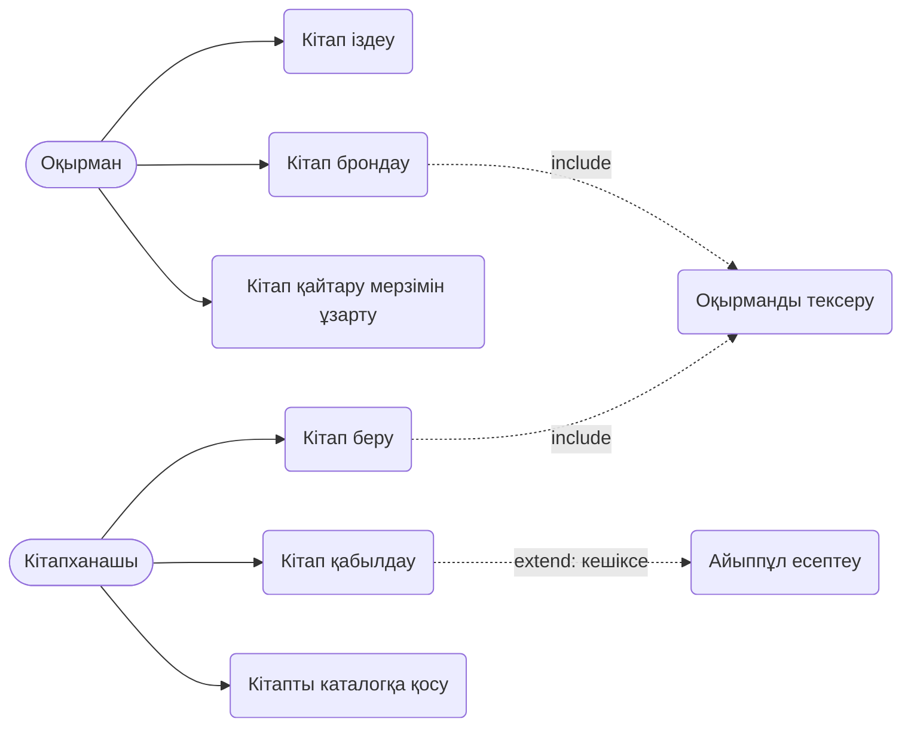

# 8-жұмыс. Use Case диаграммасын оқу: Кітапхана жүйесі

## Актерлер
- **Оқырман** — кітап іздейді, брондайды, мерзімін ұзартады.
- **Кітапханашы** — кітап береді/қабылдайды, каталогты жүргізеді.

## Сценарийлер
| Use case | Негізгі сценарий |
|---|---|
| Кітап іздеу | Оқырман атауын/авторын енгізеді → жүйе нәтиже мен қолжетімділікті көрсетеді |
| Кітап брондау | Оқырман кітап таңдайды → жүйе оқырманды тексереді → бронь жасалады |
| Кітап беру | Кітапханашы бронь/билет сканерлейді → оқырман тексеріледі → кітап беріледі, мерзім белгіленеді |
| Кітап қабылдау | Кітапханашы кітапты қабылдайды → кешіксе, айыппұл есептеледі |

## Байланыстар
- **include** (міндетті): «Кітап беру» және «Кітап брондау» әрқашан «Оқырманды тексеру»-ді қосады.
- **extend** (шартты): «Кітап қабылдау» кезінде тек кешіксе «Айыппұл есептеу» орындалады.
