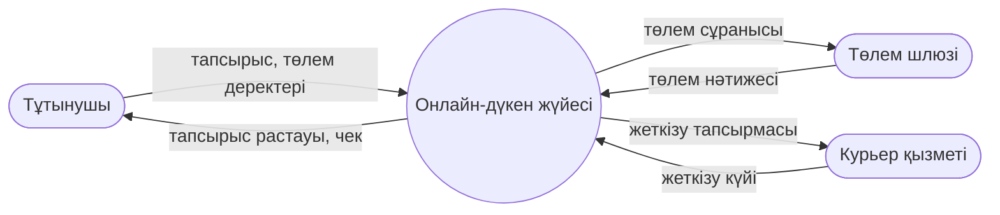
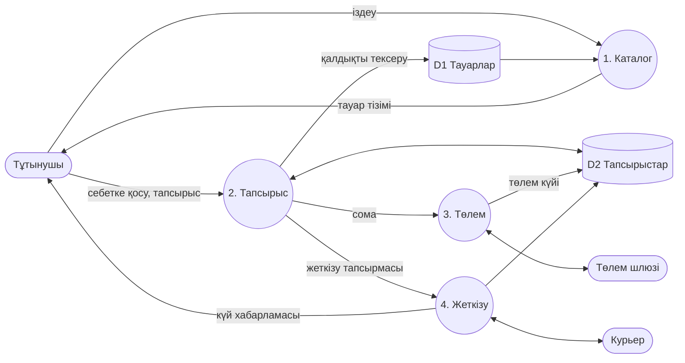

# 11-жұмыс. Онлайн-дүкен DFD талдауы
## Деңгей 0 (контекст)

## Деңгей 1

## Ағындар сипаттамасы
| Элемент | Түрі | Сипаттама |
|---|---|---|
| Тұтынушы | Сыртқы объект | Іздейді, тапсырыс береді, төлейді |
| Төлем шлюзі | Сыртқы объект | Төлемді растайды |
| Курьер қызметі | Сыртқы объект | Жеткізеді, күйді қайтарады |
| 1–4 | Процесс | Каталог, тапсырыс, төлем, жеткізу |
| D1 Тауарлар | Сақтауыш | Тауар, баға, қалдық |
| D2 Тапсырыстар | Сақтауыш | Тапсырыс, төлем және жеткізу күйі |
| Тапсырыс деректері | Ағын | Тұтынушы → 2. Тапсырыс |
| Төлем сұранысы | Ағын | 3. Төлем → шлюз |
| Жеткізу күйі | Ағын | Курьер → 4. Жеткізу → тұтынушы |
